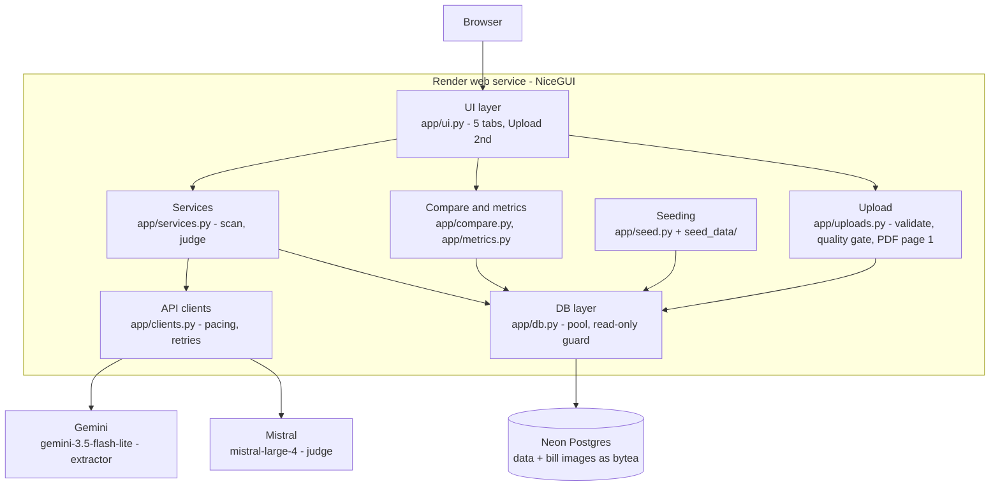
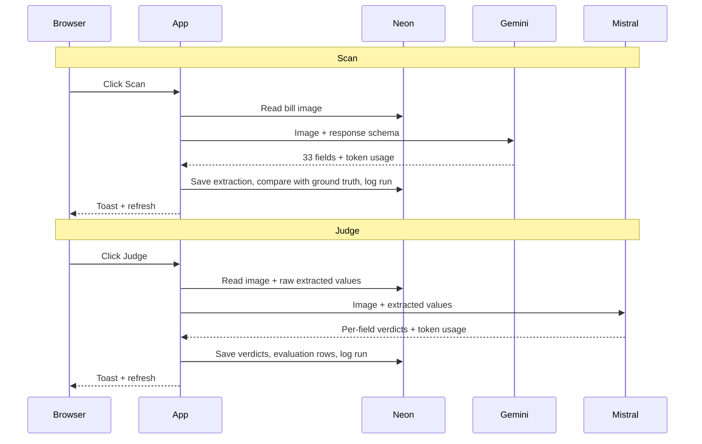
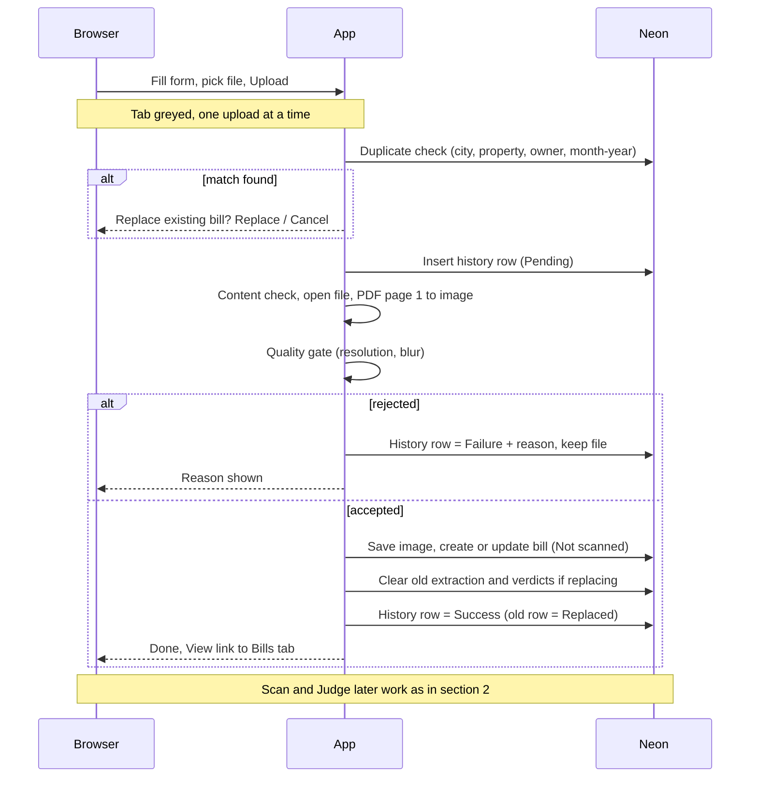

# BillSense architecture

Living document. Updated whenever the design changes (see the change log at the bottom).
Diagrams are Mermaid, so GitHub renders them.

## 1. High-level design

Components
- **UI layer:** Bills, Extracted data, Evaluation and Field guide tabs (the last three built on first open). One scan or judge at a time, triggered by the user.
- **Services:** orchestrates a scan or judge, enforces one in-flight provider call, applies the daily Gemini cap, logs every call.
- **Compare and metrics:** field normalisation and exact-match, arithmetic consistency, accuracy, judge quality, usage, latency, reliability, noise split.
- **API clients:** Gemini (structured output) and Mistral (JSON mode), with request pacing and retry/backoff on 429, 5xx and network errors.
- **DB layer:** connection pool (one warm connection) for the Neon pooled endpoint, plus an in-memory read cache cleared on every write. All writes are refused unless `APP_MODE=deployed`.
- **Seeding:** on each deploy start, creates the schema and tops up the 100 synthetic bills (40 owners, 10 cities) with ground truth. Append-only: only missing bills are inserted, nothing is updated or deleted. Property ids are allocated at insert time (uploads also use max+1), so they never clash.

## 2. Call flow

Notes
- The judge never sees ground truth. Ground truth is only used afterwards to score the extractor and the judge.
- A re-scan overwrites the stored extraction and clears its judge verdicts. `extraction_runs` keeps every call.
- Failed calls are logged to `extraction_runs` with the error text.

### 2a. Upload flow (no Gemini or Mistral call)

Notes
- Stages shown to the user are the real steps: Uploading, Validating, Quality check, Saving.
- Rows left Pending for more than 10 minutes are set to Failure (Interrupted) when the page loads.

## 3. Data model (summary)

`owners` → `properties` (one account_id each) → `bills` (noise_level, bill period) → `bill_images` (bytea), `extractions` (primary columns + secondary JSONB + raw JSON), `ground_truth` (JSON), `eval_results` (per field: match, judge verdict, agreement), `extraction_runs` (append-only call log). `uploads` (history of every upload attempt, with status, reason and the rejected file) and `bills.source` (sample or upload, backend only). A replaced sample bill becomes source=upload and leaves the ground-truth metrics. `eval_results.extractor_match` is NULL for uploaded bills (no ground truth).

## 4. Deployment

- Render free web service from this repo (`render.yaml`), Neon free Postgres (pooled connection string).
- Environment: `APP_MODE`, `DATABASE_URL`, `GEMINI_API_KEY`, `MISTRAL_API_KEY`, optional model names, `GEMINI_DAILY_CAP`.
- No authentication (agreed). Free tier sleeps after idle; first load can take about a minute.

## Change log

| Date | Change |
|---|---|
| 2026-11-07 | Initial architecture, as built. Mistral reply parsing accepts chunked content. |
| 2026-11-07 | Bills tab: rows expand in place with image and extracted-vs-truth field table; Account ID column (blank until scanned). The Bills query now also reads the extracted account ID, and the bills table loads evaluation rows for the detail panel. Evaluation tab: judge confusion matrix, per-field table limited to 10 with expand, definitions. No new components or external calls. |
| 2026-11-07 | Main page `response_timeout` raised from 3s to 30s: the first page build runs several Neon queries (cold start on free tiers) and was returning HTTP 500. |
| 2026-11-09 | Bills tab: "Bill reading period" column (month-year of extracted period end, blank until scanned) with period and scan-status filters joined to the cascade. Extracted data tab: expand removed, all 33 columns with column chooser, value filter, CSV download of selected rows (new `app/export.py`). Evaluation: info icons. New Field guide tab (`MEANINGS` in `app/fields.py`). Speed: DB read cache invalidated on writes, lean extracted-rows query, pool min_size 1, startup cache warm, lazy tab build, slow-query logging. No new external components. |
| 2026-11-09 | Upload tab built. New `app/uploads.py` (content check, PDF page 1 render, resolution and blur gate), `uploads` table, `bills.source`. New dependencies: Pillow, numpy, PyMuPDF. Upload makes no model call; Scan and Judge unchanged. Evaluation gets a judge-only section for uploaded bills. |
| 2026-11-09 | Sample data scaled from 20 to 100 bills (requirements 3a). `generate_bills.py --extend` appends bills 21 to 100 (bills 1 to 20 unchanged). `app/seed.py`: `seed_if_empty` replaced by append-only `seed_missing`. No schema change, no new components. |
