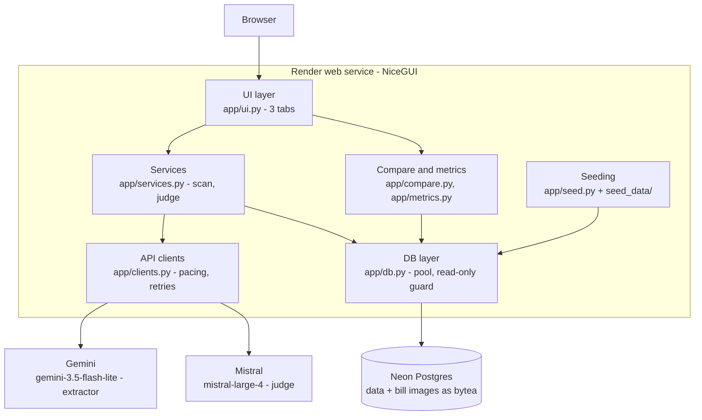
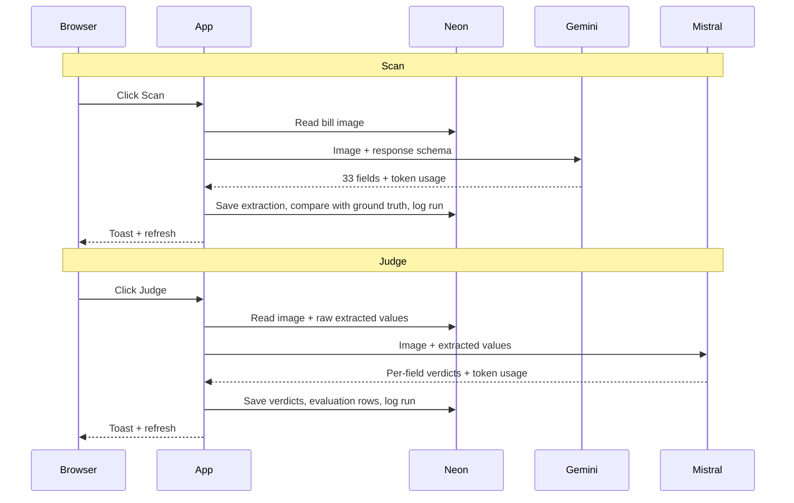

# BillSense architecture

Living document. Updated whenever the design changes (see the change log at the bottom).
Diagrams are Mermaid, so GitHub renders them.

## 1. High-level design

Components
- **UI layer:** Bills, Extracted data and Evaluation tabs. One scan or judge at a time, triggered by the user.
- **Services:** orchestrates a scan or judge, enforces one in-flight provider call, applies the daily Gemini cap, logs every call.
- **Compare and metrics:** field normalisation and exact-match, arithmetic consistency, accuracy, judge quality, usage, latency, reliability, noise split.
- **API clients:** Gemini (structured output) and Mistral (JSON mode), with request pacing and retry/backoff on 429, 5xx and network errors.
- **DB layer:** connection pool for the Neon pooled endpoint. All writes are refused unless `APP_MODE=deployed`.
- **Seeding:** on first deploy start, creates the schema and loads the 20 synthetic bills and ground truth if the database is empty.

## 2. Call flow

Notes
- The judge never sees ground truth. Ground truth is only used afterwards to score the extractor and the judge.
- A re-scan overwrites the stored extraction and clears its judge verdicts. `extraction_runs` keeps every call.
- Failed calls are logged to `extraction_runs` with the error text.

## 3. Data model (summary)

`owners` → `properties` (one account_id each) → `bills` (noise_level, bill period) → `bill_images` (bytea), `extractions` (primary columns + secondary JSONB + raw JSON), `ground_truth` (JSON), `eval_results` (per field: match, judge verdict, agreement), `extraction_runs` (append-only call log).

## 4. Deployment

- Render free web service from this repo (`render.yaml`), Neon free Postgres (pooled connection string).
- Environment: `APP_MODE`, `DATABASE_URL`, `GEMINI_API_KEY`, `MISTRAL_API_KEY`, optional model names, `GEMINI_DAILY_CAP`.
- No authentication (agreed). Free tier sleeps after idle; first load can take about a minute.

## Change log

| Date | Change |
|---|---|
| 2026-11-07 | Initial architecture, as built. Mistral reply parsing accepts chunked content. |
| 2026-11-07 | Bills tab: rows expand in place with image and extracted-vs-truth field table; Account ID column (blank until scanned). The Bills query now also reads the extracted account ID, and the bills table loads evaluation rows for the detail panel. Evaluation tab: judge confusion matrix, per-field table limited to 10 with expand, definitions. No new components or external calls. |
| 2026-11-07 | Main page `response_timeout` raised from 3s to 30s: the first page build runs several Neon queries (cold start on free tiers) and was returning HTTP 500. |
