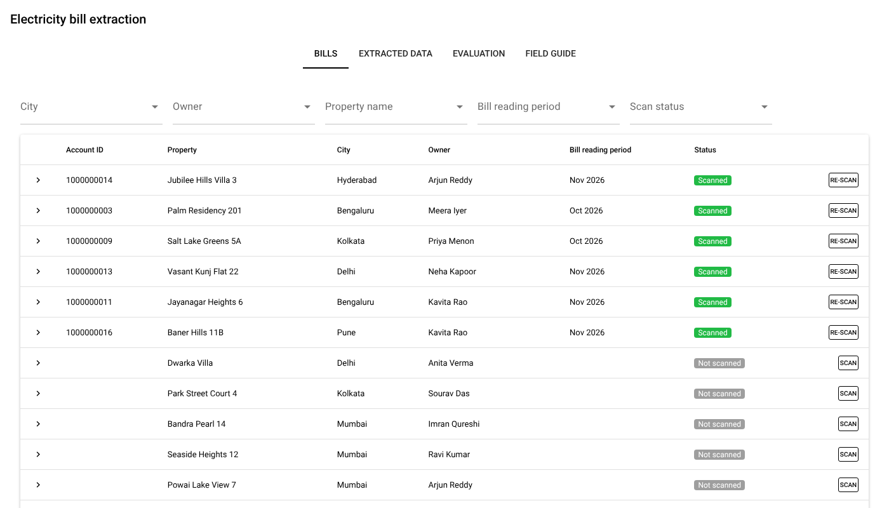
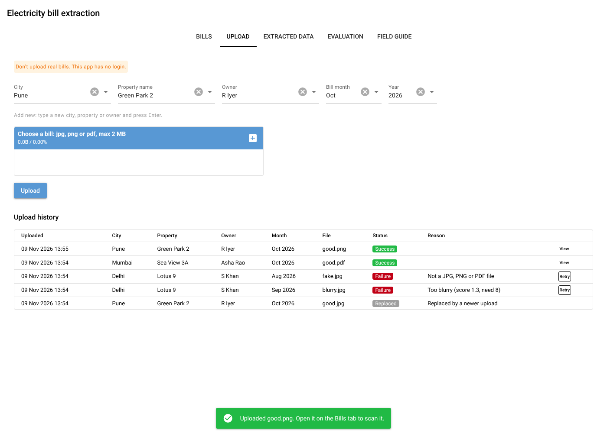
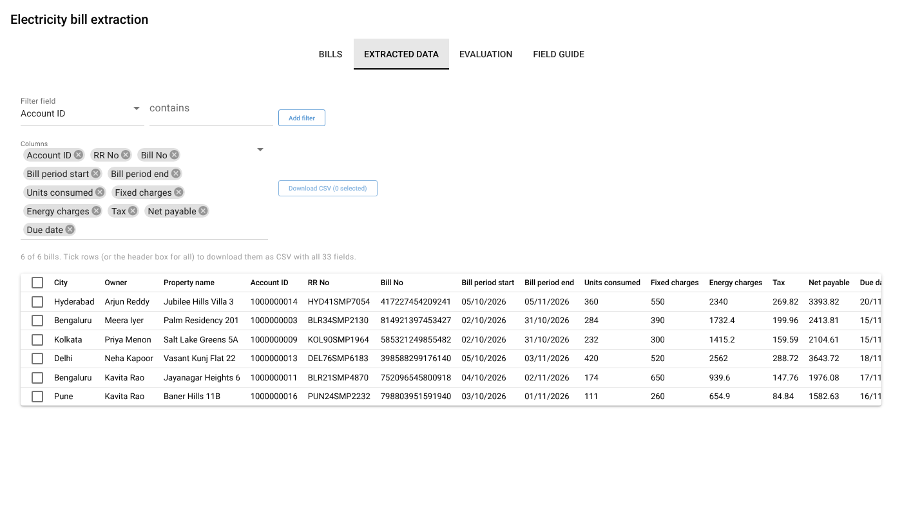
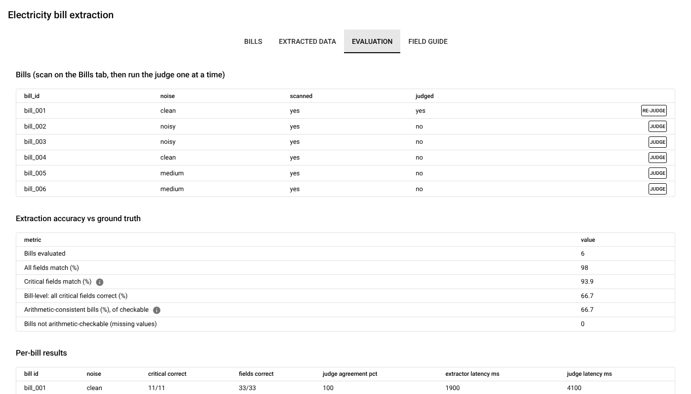
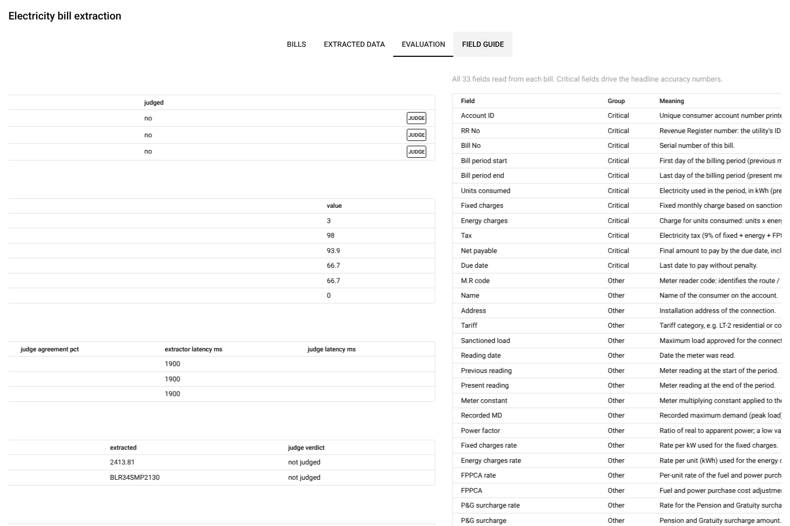

# BillSense: electricity bill extraction

## The problem
Indian businesses that manage properties, whether owned, leased or rented, struggle to digitise how electricity bill details are captured and passed to accounting and payment systems accurately, with little manual intervention.

## What it does
BillSense reads electricity bill images with an extractor model (Gemini), checks the result with a judge model (Mistral),
and shows how accurate, fast and reliable both models are.

## Screens
| Screen | What you can do |
|---|---|
| Bills | Filter by city, owner, property, bill reading period and scan status. Scan a bill. Expand a row to see the image and extracted vs ground-truth fields. |
| Upload | Upload your own bill (jpg, png, pdf up to 2 MB). Unclear files are rejected. Upload history with View and Retry. Replace an existing bill after a prompt. |
| Extracted data | All 33 fields per scanned bill. Choose columns, filter rows by value, download selected rows as CSV. |
| Evaluation | Accuracy, judge quality, usage, latency, reliability, split by noise level. |
| Field guide | Every field with its meaning. |







## Key functional requirements
- Bill upload: city, property, owner, bill month-year, a jpg, png or pdf up to 2 MB with content, resolution and blur checks, a prompt before replacing a duplicate, and a history with a link to the bill. Uploading makes no model call; scan and judge stay manual. See `requirements.md` section 4.8.
- Extract 33 bill fields with the extractor model (Gemini), then review them with the judge model (Mistral). One bill at a time, started by the user.
- Analyse extracted fields in the app and export them as CSV.
- Review extraction accuracy, judge accuracy, model latency and reliability metrics.

## Key technical requirements
- Sub-second response for app users. Reads are cached in memory (cleared on every write) and heavy tabs load on first open. The free Render (app hosting) and Neon tiers (Postgres DB hosting) can still take up to a minute to wake after idle.
- Free tiers only: Render web service, Neon Postgres, Gemini and Mistral free plans.
- All data lives in Neon, including bill images as `bytea`. No other storage.
- Provider limits respected: request pacing, retry with backoff, daily Gemini cap, one provider call at a time.
- No authentication (agreed). Do not upload real bills.
- Writes are allowed only when `APP_MODE=deployed`. Local runs are read-only.
- Secrets only in environment variables.

## Challenges faced and mitigation

### Model related constraints
- Mistral rejected greedy sampling when the `top_p` parameter was not defined and forced `top_p` to be 1. This means it considers the full probability distribution, even though greedy picks only the top token.
- Mistral sometimes returns the response as a list of chunks, which broke parsing: the parser accepts both forms and falls back to the JSON braces.
- Judge LLM verdicts are sometimes omitted or garbled, so they are stored as missing. A missing verdict is counted as a miss only when the extractor was wrong.
- Free-tier rate limits and quotas: pacing, retries that honour `Retry-After`, a daily cap on requests and a single in-flight call.

### Page load taking longer than a few milliseconds
- Slow loads: Render (Singapore) and Neon (US) are far apart and tabs re-queried every time. A same-region move for the Render UI is pending.
- The first page load returned HTTP 500 on cold start from Render: the page response timeout was raised from 3 s to 30 s.
- Added an in-memory cache, lean queries, a warm connection and lazy tabs.

### Evaluation metrics
- Evaluation metrics were a bit hard to read: added a confusion matrix (compares extractor vs LLM judge outputs), and info icons and plain definitions for a few metrics.

This is still a work in progress and needs to be further improved.

## How to access the app
App URL: https://billsense-c76d.onrender.com/ (free tier: the first load after idle can take about a minute).

### Run on your machine
1. Install Python 3.11 or newer.
2. Clone the repo and install: `pip install -r requirements.txt`
3. Copy `.env.example` to `.env` and fill in `DATABASE_URL` (a Neon pooled connection string).
4. Add `GEMINI_API_KEY` and `MISTRAL_API_KEY` if you want to scan and judge.
5. Export the variables, then run `python main.py` and open http://localhost:8080
6. Default mode is read-only. For scanning, judging and first-start seeding set `APP_MODE=deployed`. This writes to the database in `DATABASE_URL`.

### Deploy on Render
Create a Web Service from this repo (free plan). Set `APP_MODE=deployed`, `DATABASE_URL`, `GEMINI_API_KEY` and `MISTRAL_API_KEY`.
On start the schema is created and any of the 100 bundled sample bills missing from the database are added (append-only: existing bills, scans and uploads are never changed). `render.yaml` holds the defaults.

### Tests
```
pip install -r requirements-dev.txt
export TEST_DATABASE_URL=postgresql://user@localhost:5432/billtest   # throwaway database; its public schema is DROPPED
pytest
```

## More
- `requirements.md`: agreed requirements and decisions.
- `ARCHITECTURE.md`: high-level design, call flow, data model, change log.
- Optional env vars: `UPLOAD_MIN_SHORT_SIDE` (500), `UPLOAD_MIN_BLUR_SCORE` (8), `UPLOAD_MAX_PIXELS` (25000000), `GEMINI_DAILY_CAP` (default 450), `*_PRICE_IN_PER_M` and `*_PRICE_OUT_PER_M` (enable the cost metric), `GEMINI_MODEL`, `MISTRAL_MODEL`.
